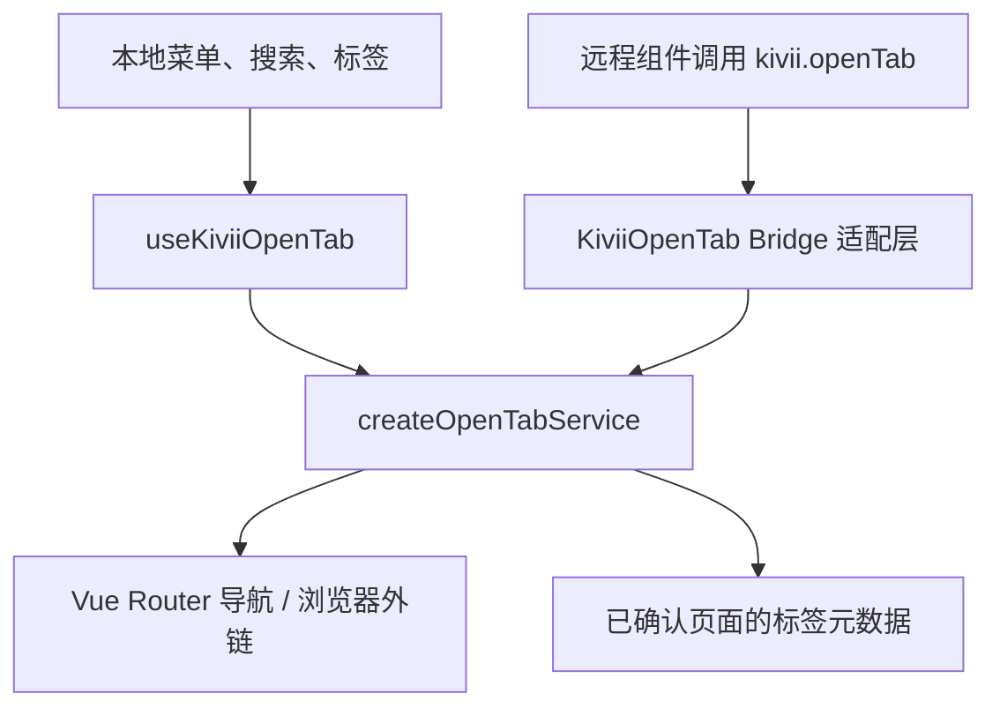

# OpenTab 使用指南

OpenTab 的业务逻辑统一位于 `src/services/open-tab.ts`。Vue composable 和 Kivii Bridge 分别为本地页面与远程组件提供入口，共享路径处理、菜单查找、选项语义和导航结果。



## 项目文件

| 文件 | 职责 |
| --- | --- |
| `src/services/open-tab.ts` | 唯一业务实现；接收 Router 与菜单 Store |
| `src/composables/useKiviiOpenTab.ts` | 在 Vue setup 中提供 Router、Store 并返回服务方法 |
| `src/bridge/kivii-open-tab.ts` | 适配 `IOpenTab`，保留旧快捷函数导出 |
| `src/bootstrap/workspace.ts` | 初始化工作台时注册 Bridge 实现 |

composable 直接调用共享服务，不再先调用 Bridge、失败后再执行一遍路由回退。直接通过 Vue Router 打开的页面仍由全局守卫和布局维护标签。

## 方法

| 方法 | 说明 |
| --- | --- |
| `openTab(url, options)` / Bridge 的 `open(url, options)` | 打开 HTTP(S) 外链或内部路由 |
| `openPath(path, options)` | 打开内部路由；HTTP(S) 地址按外链处理 |
| `openByKvid(kvid, options)` | 递归查找菜单的 KVID 或 key，打开对应路径 |
| `openMenuItem(item, options)` | 打开菜单项；composable 提供 |
| `findPathInfo(path)` / `findPathInfoByKvid(kvid)` | 查询菜单信息；composable 提供 |

导航方法返回 `Promise<boolean>`：

- 内部导航等待 Vue Router 完成；重复访问当前地址视为成功。
- 守卫阻止、导航取消、导航抛错、空路径或未知 KVID 返回 `false`。
- 未知 KVID 不会额外跳转首页。
- 路由重定向遵循 Router 规则；成功表示导航完成，不表示最终页面一定是原请求页面。
- 外链返回 `true` 表示已发起浏览器导航；浏览器仍可能限制弹窗。

## 选项

```ts
interface OpenTabOptions {
  newTab?: boolean;
  activateExisting?: boolean;
  replace?: boolean;
}
```

| 选项 | 语义 |
| --- | --- |
| `newTab` | 仅用于外链；默认在新窗口打开，`false` 使用当前窗口。内部路由始终使用工作台标签，不强制创建重复标签 |
| `activateExisting` | 默认 `true`；设为 `false` 且标签已经存在时，保留当前页面，不修改已有标签的参数。标签尚不存在时正常导航 |
| `replace` | 内部导航使用 `router.replace`；外链且 `newTab: false` 时使用 `location.replace` |

内部路径保留 query 和 hash，例如 `orders?id=123#details` 会导航到 `/orders?id=123#details`。菜单查找及标签身份仍按路径 `/orders` 匹配，同一路径的不同参数不会创建多个标签。

## 本地 Vue 页面

```ts
import { useKiviiOpenTab } from '@/composables/useKiviiOpenTab';

const { openTab, openPath, openByKvid, openMenuItem } = useKiviiOpenTab();

await openPath('/orders?id=123#details');
await openByKvid('orders-menu-kvid');
await openMenuItem(menuItem);
await openTab('https://example.com', { newTab: false });
```

## Bridge 调用

宿主提供 `window.kivii` 的运行环境可以调用：

```ts
await window.kivii.openTab.openPath('/orders?id=123#details');
await window.kivii.openTab.openByKvid('orders-menu-kvid');
await window.kivii.openTab.open('https://example.com');
```

本地旧代码仍可从 `@/bridge/kivii-open-tab` 导入 `openTab`、`openTabPath`、`openTabByKvid`；这些快捷函数通过已经注册的 Bridge 适配层调用同一服务。

## 验证

`tests/open-tab-service.spec.ts` 使用真实的内存 Router 验证参数保留、守卫等待、导航失败、重定向、菜单身份与选项行为。`tests/e2e/page-host.spec.ts` 验证生产页面中的 Bridge、标签点击及 PageHost 的配合。
