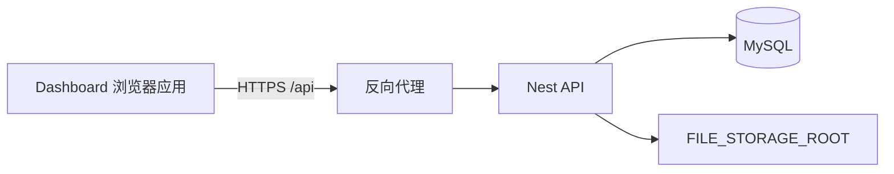

# 自建 API 接入

`Dashboard-lightWeight-Api` 使用 Nest API、MySQL 和服务端本地文件目录。浏览器只访问同站点的 `/api`，不直接连接数据库或文件目录。



## 本地启动

当前分支将 Nest API 放在 `server/`。首次运行先复制并填写数据库配置：

```bash
cp server/.env.example server/.env
```

确保本机 MySQL 已启动后，可在根目录执行：

```bash
pnpm dev
```

启动脚本会检查后端依赖、执行 TypeORM 迁移、初始化本地演示管理员、启动 Nest API，并在 API 就绪后启动 Vite。需要分开调试时使用 `pnpm dev:api` 和 `pnpm dev:web`。

## 前端配置

复制环境变量示例并启动前端：

```bash
cp .env.example .env
pnpm install
pnpm dev
```

```dotenv
VITE_API_BASE_URL=/api
```

开发服务器监听 `127.0.0.1:5173`，把 `/api` 代理到 `http://127.0.0.1:3000`，并移除转发路径中的 `/api` 前缀。生产环境应提供同样的同源代理；刷新令牌 Cookie 的路径需要从 `/auth` 改写为 `/api/auth`。

## 响应和认证

JSON 接口使用统一响应格式：

```json
{
  "status": 200,
  "message": "success",
  "Results": {},
  "Total": 1
}
```

登录成功后，访问令牌只保存在应用内存中，通过 `Authorization: Bearer <accessToken>` 调用受保护接口。刷新令牌由 `HttpOnly` Cookie 保存。页面重新打开、访问令牌临近过期或接口返回 `401` 时，前端调用 `POST /auth/refresh`，更新访问令牌并重试原请求。所有请求使用 `credentials: 'include'`。

生产环境必须使用 HTTPS，并配置实际的 `FRONTEND_ORIGIN`。刷新 Cookie 使用 `SameSite=Strict`，因此前端与 API 应部署在同一站点。

## 认证与用户接口

| 方法 | 路径 | 说明 |
| --- | --- | --- |
| `POST` | `/users` | 注册用户，提交 `name`、`email`、`password` |
| `POST` | `/auth/login` | 登录并返回访问令牌 |
| `POST` | `/auth/refresh` | 轮换刷新 Cookie 并返回新访问令牌 |
| `GET` | `/auth/me` | 获取当前用户 |
| `GET` | `/users/me` | 获取本人资料，包含 `name` 和 `avatarFileId` |
| `PATCH` | `/users/me` | 更新本人显示名称，提交 `name`（去除首尾空格，1–100 字符） |
| `POST` | `/users/me/avatar` | multipart `file` 上传并绑定本人头像，最大 2MB |
| `GET` | `/users/me/avatar` | 携带访问令牌读取本人头像图片 |
| `POST` | `/auth/change-password` | 修改密码并撤销全部已有会话 |
| `POST` | `/auth/logout` | 撤销当前刷新会话 |
| `GET` | `/users` | 普通用户只查看本人，超级管理员查看全部 |
| `GET` | `/users/:id` | 本人或超级管理员查看 |

密码为 8–128 位，必须同时包含字母、数字和符号，不能包含空格。同一邮箱在 15 分钟内连续失败 10 次后锁定 15 分钟。数据库只保存带随机盐的密码哈希。

## 个人资料与头像

应用统一使用 Nest 用户信息显示顶栏和个人中心，不再读取 `KiviiContext` 或调用旧 Member 接口。登录、续期和资料更新响应均包含头像文件 ID；前端保存成功后立即更新姓名，并通过带 Bearer 令牌的请求读取私有头像，转为 Blob URL 展示。账号切换时释放旧头像 URL。

头像仅支持 PNG、JPEG、GIF 和 WebP，服务端校验文件头及 2MB 大小限制，不接受 SVG。文件存入现有本地存储，`users.avatar_file_id` 记录绑定关系；删除头像文件时外键自动清空绑定。替换头像后旧文件仍在本人文件存储中，可自行删除。头像访问仅允许当前登录用户，浏览器不直接通过无认证图片 URL 请求文件。

更新既有部署前，在 `server/` 执行 `npm run migration:run`，应用 `AddUserAvatar1790050000000` 迁移，再启动新版 API。公开只读演示账号仍受 `DEMO_READONLY` 限制；修改密码沿用撤销全部会话的行为，前端会回到登录页。

## Dashboard 接口

| 方法 | 路径 | 说明 |
| --- | --- | --- |
| `GET` | `/dashboard-functions` | 查询功能列表 |
| `POST` | `/dashboard-functions` | 新增或按 `kvid` 更新功能 |
| `PATCH` | `/dashboard-functions/:kvid` | 更新功能字段 |
| `DELETE` | `/dashboard-functions/:kvid` | 删除功能 |
| `POST` | `/dashboard-functions/import` | 批量导入功能 |
| `GET` | `/dashboard-admin/me/roles` | 当前用户角色 |
| `GET` | `/dashboard-admin/menus/runtime?internalCode=...` | 当前用户可见菜单 |
| `GET` | `/dashboard-admin/menus/autostart?menuRootKvid=...` | 自动启动菜单 |
| `GET` | `/dashboard-admin/admin/menu-config` | 管理端菜单、菜单根和功能配置 |
| `GET` | `/dashboard-admin/admin/permissions` | 管理端用户、角色和权限配置 |
| `PUT` | `/dashboard-functions/:kvid/access` | 同时替换普通用户功能授权和部门授权，提交 `roleKvids`（空数组或普通用户角色 ID）、`departmentIds` |
| `GET` | `/dashboard-admin/admin/departments` | 组织部门列表 |
| `POST` | `/dashboard-admin/admin/departments` | 新增或更新组织部门，包含类型、简称、全称、上级，以及可选的地址、助记码和内部编码 |
| `DELETE` | `/dashboard-admin/admin/departments/:id` | 删除无下级和成员的部门 |
| `PUT` | `/dashboard-admin/admin/departments/:id/users` | 将所选用户批量添加到部门，提交 `userIds` |
| `PUT` | `/dashboard-admin/admin/users/:userId/department` | 设置用户所属部门，提交 `departmentId`，传 `null` 可清空 |
| `PUT` | `/dashboard-admin/admin/users/:userId/app-role` | 设置账号角色，提交 `role` 为 `user` 或 `super_admin`；变更后撤销该用户现有会话 |

带 `/dashboard-admin/admin/` 的接口和功能写接口要求超级管理员。普通用户只能读取自己的角色以及经过权限过滤的运行时菜单。

每位用户最多属于一个部门。普通用户可见功能为**普通用户功能授权与部门授权的交集**；部门继承启用的上级部门授权，停用节点会中断向更上级的继承。超级管理员不受此交集限制。迁移清空已有普通用户功能授权；旧自定义角色及用户绑定不参与访问判断。`dashboard_departments`、`dashboard_department_functions` 和 `users.department_id` 由迁移创建；现有用户默认未分配部门，需由管理员分配后才能访问依赖部门授权的功能。修改授权后，新生成的运行时菜单会使用当前权限。

组织节点使用 `kind`（`organization` 或 `department`）。顶层组织填写简称、全称、地址和可选的内部编码；部门填写名称、负责人 `manager_user_id`、楼层 `floor` 和可选的内部编码。负责人必须是已有用户，未指定时为 `null`。顶层节点只能是组织，下级节点只能是部门；画布顶部创建顶层组织，节点上的“+”创建下级部门。内部编码填写时必须在组织内唯一。旧节点的类型和全称由迁移补齐。

## 文件存储接口

| 方法 | 路径 | 说明 |
| --- | --- | --- |
| `POST` | `/files` | `multipart/form-data` 上传，字段名为 `file` |
| `GET` | `/files` | 普通用户查看本人文件，超级管理员查看全部 |
| `GET` | `/files/:id/download` | 本人或超级管理员下载 |
| `DELETE` | `/files/:id` | 本人或超级管理员删除 |

文件内容写入 `FILE_STORAGE_ROOT`，元数据写入 MySQL 的 `stored_files`。默认单文件上限为 50 MB，每位用户总量上限为 1 GB；生产环境应使用持久卷并纳入备份。

## UMD 导入和版本

UMD Runtime Lab 使用 `multipart/form-data` 调用 `POST /dashboard-functions/import-umd`，字段包括：

- `file`：原始 `.js` 文件；
- `manifest`：Manifest JSON 字符串；
- `components`：组件清单 JSON 字符串；
- `moduleKey`：组件库稳定标识；
- `name`：显示名称；
- `version`：版本号。

| 方法 | 路径 | 说明 |
| --- | --- | --- |
| `GET` | `/dashboard-functions/umd-versions?moduleKey=...` | 查询版本记录 |
| `PUT` | `/dashboard-functions/umd-versions/:id/activate` | 启用指定历史版本 |
| `GET` | `/dashboard-assets/:versionId/:fileName` | 加载不可变 UMD 文件 |

启用版本后，服务端更新同一 `source_module` 下功能记录的 `source_url`。运行时菜单返回该地址，PageHost 在用户打开菜单时加载对应脚本。

## 生产代理示例

下面只展示关键路径，域名和上游地址按部署环境调整：

```nginx
location /api/ {
  proxy_pass http://127.0.0.1:3000/;
  proxy_set_header Host $host;
  proxy_set_header X-Forwarded-Proto $scheme;
  proxy_set_header X-Forwarded-For $proxy_add_x_forwarded_for;
  proxy_cookie_path /auth /api/auth;
}

location / {
  try_files $uri $uri/ /index.html;
}
```

`HTTPS_TERMINATED_BY_PROXY=1` 时 API 只信任本机代理追加的 `X-Forwarded-For`，按 IP 的登录和注册限流依赖这个请求头；缺少时所有请求会共用代理 IP 的额度。限流计数保存在进程内存中，多实例部署需要改为共享存储。每个限流器最多保存 10,000 个 IP，每分钟清理过期记录；容量达到上限时，新来源返回 503 和 `Retry-After`，已有来源继续按原额度限流。

公开演示环境应设置 `DEMO_READONLY=1`：`DEMO_ADMIN_EMAIL` 对应的账号仍可浏览全部管理界面，但所有写操作（上传、导入 UMD、修改菜单与权限、修改密码等）返回 403。

部署前在后端运行 TypeORM 迁移，并配置 MySQL、`FRONTEND_ORIGIN`、JWT 密钥、HTTPS 证书和 `FILE_STORAGE_ROOT`。
